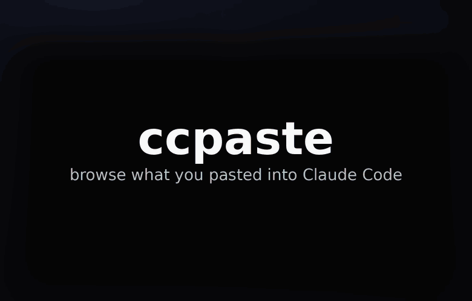
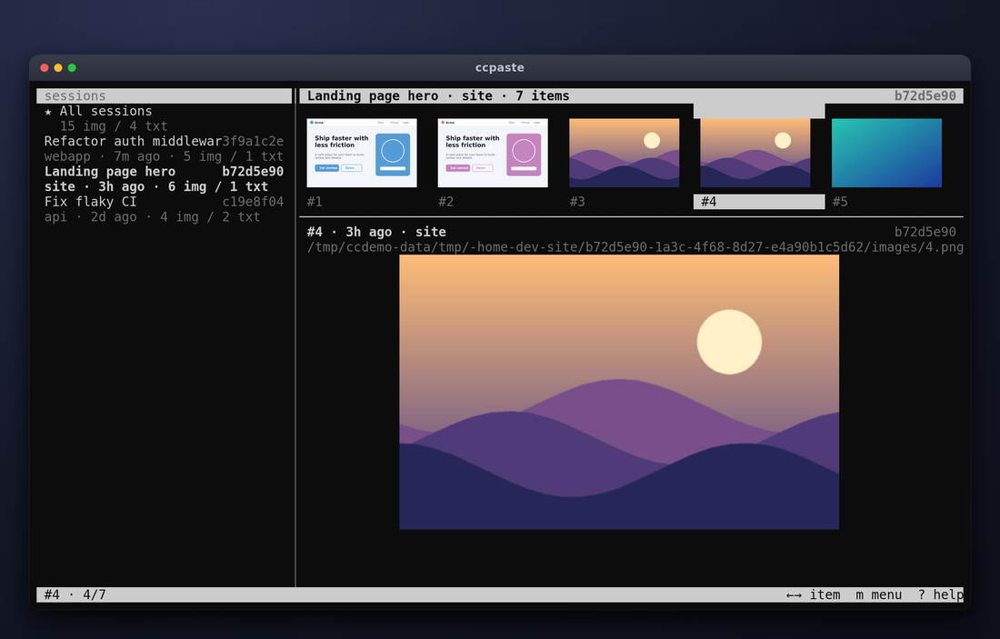
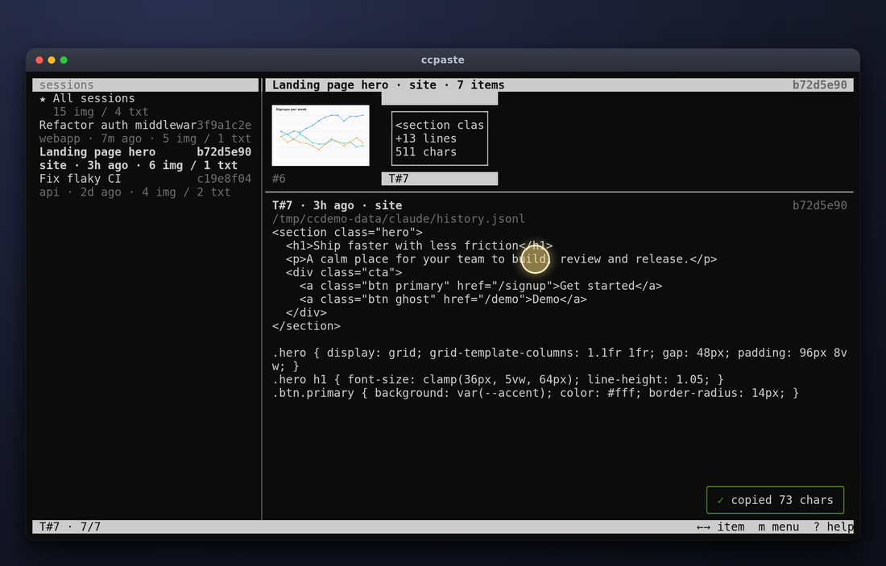
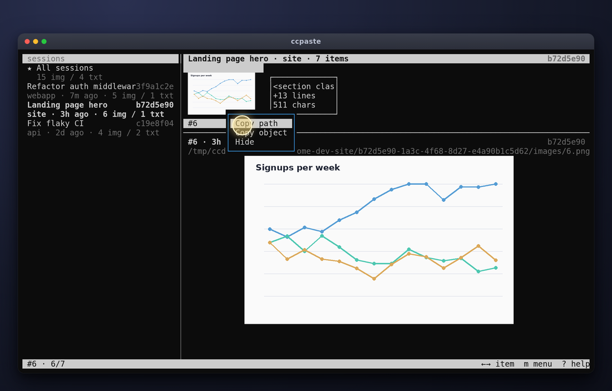

# ccpaste

清晰預覽你貼進 Claude Code 的所有內容：圖片與文字、每個 session，透過 Sixel 直接在終端機中顯示。

[English](README.md) | 繁體中文



## 為什麼需要它

Claude Code 只有在支援 kitty graphics protocol、Ghostty 或 iTerm2 的終端機才會畫出真正的圖片。其他環境，例如 WSL 下的 Windows Terminal，貼上的圖片只會顯示成模糊的半格字元縮圖。ccpaste 是一個小型 TUI，在 Claude Code 旁邊另開一個窗格執行：左側列出你的 session，右側透過 Sixel 清晰繪製所選 session 貼上的圖片，以及較長的文字貼上內容，標籤沿用 Claude Code 的命名（圖片為 `#1`、`#2`，文字貼上為 `T#5`）。

## 功能

- 以 Sixel 清晰預覽貼上的圖片：縮圖列加上大圖預覽。
- 較長的文字貼上以純文字自動換行顯示、可捲動，並使用與 Claude Code 相同的 `T#N` 標籤。
- Session 側邊欄（最新的在前，另有「All sessions」總覽）；新的項目與 session 會自動出現。
- 鍵盤與滑鼠皆可操作：類 vim 按鍵、點擊、滾輪、拖曳複製，以及右鍵快顯選單。
- 可將路徑、文字貼上內容或圖片本身複製到剪貼簿（各平台實作見「快顯選單與提示訊息」）。
- 非破壞性的隱藏，以及可選的舊 session 自動隱藏；絕不修改 Claude Code 的檔案。
- 絕不修改 Claude Code 的檔案，也不保留你貼上內容的副本；唯一會寫入的是它自己的 `hidden.json`。
- 單一 Python 檔案，只依賴一個套件（Pillow）。

## 快速開始

需求：Python 3 與 Pillow（`pip install --user pillow`），以及支援 Sixel 的終端機，例如 Windows Terminal 1.22 或更新版本。只要終端機支援 Sixel，macOS 與 Linux 也能使用；其他終端機皆未驗證。

把單一檔案 `ccpaste` 以符號連結放到 PATH 中，然後在 Claude Code 旁邊的窗格執行：

```
ln -s "$PWD/ccpaste" ~/.local/bin/ccpaste
ccpaste
```

（直接把檔案複製到 PATH 也可以。）

## 截圖



*左側為 session；右側為縮圖列與所選圖片的大圖預覽。*



*以文字顯示的文字貼上內容（`T#7`）；選取文字即複製，並以綠色「copied N chars」提示訊息確認。*



*按右鍵（或 `m`）開啟快顯選單：Copy path、Copy object、Hide。*

## 使用方式

```
ccpaste                  # sidebar of sessions, newest first
ccpaste -s <id-prefix>   # open one session directly (ambiguous prefix lists candidates and exits 1)
ccpaste --list           # print the sessions (title, id, project, time, counts) and exit
ccpaste --list -s <id>   # print that session's item labels and exit
```

* `ccpaste`：顯示 session 側邊欄，最新的在前。
* `ccpaste -s <id-prefix>`：直接開啟單一 session（前綴有歧義時會列出候選項並以 1 結束）。
* `ccpaste --list`：印出 session（標題、id、專案、時間、數量）後結束。
* `ccpaste --list -s <id>`：印出該 session 的項目標籤後結束。

畫面分為兩半：左側是 session 側邊欄（第一列為「All sessions」，之後每個 session 兩行：第一行為標題與 8 個字元的 id，第二行為專案、距今時間與數量），右側是所選 session 的內容（縮圖列、資訊列、大圖預覽）。未使用 `-s` 時，側邊欄預設焦點在最新的 session；使用 `-s` 時，預設焦點在右側窗格。新的項目與 session 會自動出現（約每秒輪詢一次）；目前顯示的 session 中新到達的項目會成為選取項目。

| 焦點 | 按鍵 | 動作 |
|---|---|---|
| 側邊欄 | Up / Down, k / j | 上一個 / 下一個 session（右側即時更新） |
| 側邊欄 | g / G | 第一列 / 最後一列 |
| 側邊欄 | Enter, Right, l, Tab | 焦點移到右側窗格 |
| 右側窗格 | Left / Right, h / l | 上一個 / 下一個項目 |
| 右側窗格 | Up / Down, k / j | 移動一列縮圖 |
| 右側窗格 | g / G | 第一個 / 最後一個項目 |
| 右側窗格 | PgUp / PgDn | 將文字貼上內容捲動一頁 |
| 右側窗格 | K / J | 將文字貼上內容捲動 3 行 |
| 右側窗格 | Tab, Esc, s | 焦點移到側邊欄 |
| 兩者皆可 | b | 顯示 / 隱藏側邊欄 |
| 兩者皆可 | r | 強制重繪 |
| 兩者皆可 | d / u / H | 隱藏或取消隱藏所選項目 / 復原上一次隱藏 / 顯示已隱藏的項目 |
| 兩者皆可 | ? | 說明視窗：主要按鍵與滑鼠操作，以及目前使用的儲存格尺寸（按任意鍵關閉） |
| 兩者皆可 | m | 開啟所選項目的快顯選單（等同右鍵） |
| 兩者皆可 | y | 將所選項目的路徑複製到剪貼簿 |
| 兩者皆可 | [ / ] | 將假設的終端機儲存格尺寸縮小 / 放大 10%（圖片溢出時用來校正） |
| 兩者皆可 | q, Ctrl+C | 離開 |

## 隱藏

隱藏是非破壞性的：ccpaste 絕不修改或刪除 Claude Code 的檔案。它把自己的清單存在 `~/.config/ccpaste/hidden.json`（若有設定 `$XDG_CONFIG_HOME` 則為 `$XDG_CONFIG_HOME/ccpaste/hidden.json`；Windows 上為 `%APPDATA%\ccpaste\hidden.json`）：

```json
{"version": 1, "sessions": ["<sessionId>"], "items": ["<sid>:img:<n>", "<sid>:txt:<id>"], "auto_hide_days": null}
```

- 焦點在側邊欄時，`d` 隱藏所選 session；焦點在右側窗格時，`d` 隱藏所選項目（圖片或文字貼上）。「All sessions」無法隱藏。被隱藏的內容會從側邊欄、All 總覽、數量統計與縮圖列中消失。
- 隱藏後會跳出提示訊息「hidden ... · u to undo」；`u` 會復原最近一次隱藏（可重複復原更早的操作，僅限本次執行）。`d` 只切換所選項目：隱藏它，或取消隱藏已透過 `H` 顯示出來的項目。
- `H` 切換「顯示已隱藏」：已隱藏的 session 與項目會以暗色並帶標記顯示，此時 `d` 會取消隱藏所選項目。
- 自動隱藏：在 json 中設定 `auto_hide_days`，或傳入 `ccpaste --hide-older N`，即可隱藏最後活動時間早於 N 天前的 session。此值即時計算，絕不寫入檔案；`H` 也會顯示它們，而 `d` 不會取消隱藏它們（請改設定值）。
- 檔案以原子方式寫入。檔案遺失或損毀時視為空清單（損毀的檔案會被複製為 `hidden.json.bak`）。

頁尾刻意保持簡短：左側為你的位置（`#10 · 376/376`；在 All 總覽中，項目標籤還會帶有 4 個字元的 session 前綴），右側最多三個提示加上 `? help`。

## 滑鼠

ccpaste 執行期間會啟用滑鼠追蹤（按鈕事件追蹤，使用 SGR 座標），離開時關閉。拖曳時按住 Shift 可改用終端機本身的選取功能（視終端機而定）。

| 操作 | 效果 |
|---|---|
| 點擊側邊欄的列 | 選取該 session，並將焦點移到側邊欄 |
| 點擊縮圖 | 選取該項目，並將焦點移到右側窗格 |
| 點擊分隔線 | 顯示 / 隱藏側邊欄 |
| 在縮圖、預覽或資訊 / 路徑列上按右鍵 | 選取該項目並開啟快顯選單（Copy path、Copy object、Hide / Unhide） |
| 在側邊欄的 session 列上按右鍵 | 快顯選單（Hide / Unhide session、Copy session id） |
| 在側邊欄上滾動滾輪 | 捲動 session 清單 |
| 在縮圖上滾動滾輪 | 上一個 / 下一個項目 |
| 在文字貼上內容上滾動滾輪 | 捲動文字（在圖片上則為上一個 / 下一個項目） |
| 在文字貼上內容或路徑列上拖曳 | 反白；放開時複製所選文字 |
| 按兩下 | 選取指標下的單字並複製 |
| 拖曳超出文字貼上內容的上 / 下邊緣 | 選取時自動捲動 |

複製時會盡可能使用原生剪貼簿（Windows：Win32 API；macOS：`pbcopy`；Linux：`wl-copy`、`xclip` 或 `xsel`），否則把文字交給終端機處理（OSC 52 跳脫序列；這是 SSH 與 WSL 下的正常途徑；已確認可在 WSL 下的 Windows Terminal 運作，其他終端機未驗證）。無論哪種方式，都會以綠色提示訊息「copied N chars」確認。若是在遠端編輯器終端機中（既沒有 SSH 變數也不是 WSL 核心，但設有 `DISPLAY` / `WAYLAND_DISPLAY`，例如透過 VS Code tunnel 連到桌面版 Linux 主機），會選用本機工具，文字會進入遠端機器的剪貼簿。

## Windows（原生）

ccpaste 也能在 Windows Terminal 中從 cmd 或 PowerShell 直接執行，不需要 WSL：安裝 Python 3 與 Pillow（`pip install pillow`），使用 Windows Terminal 1.22 或更新版本（Sixel 所需），然後執行 `python ccpaste`（或 `python ccpaste -s <id>`）。它從 `%USERPROFILE%\.claude` 與 `.claude-*` 讀取 Claude Code 的檔案，並從 `<CLAUDE_CODE_TMPDIR 或 %TEMP%>\claude` 讀取貼上的圖片；圖片位置是依據第三方外掛對 Claude Code 的描述，未經驗證。**Windows 支援尚未在真實硬體上測試**：主控台設定（VT 輸入與輸出模式、raw input、關閉 quick-edit）、輸入讀取、原生剪貼簿與路徑處理皆已實作，但只有其純邏輯部分有在 Linux 上執行的測試涵蓋。若有問題，請回報。

## 快顯選單與提示訊息

按右鍵（或 `m`）會在指標處開啟一個帶邊框的小選單；靠近視窗邊緣時會向左或向上翻轉，且絕不遮住頁尾。可用滑鼠游標停留（動作追蹤僅在選單開啟時啟用），或用 Up / Down / j / k 與 Enter 操作；Esc、`q` 或點擊選單外部即可關閉。每個項目（圖片或文字）都有相同的選單：

- **Copy path**：圖片的檔案路徑；文字貼上則是其 paste-cache 檔案路徑（若有），否則是來源的 `history.jsonl`。
- **Copy object**：文字貼上的完整文字，或將圖片本身放進剪貼簿（可貼到其他應用程式，包括 Claude Code）。圖片後端：Windows 原生（`CF_DIB` 加上 `PNG` 格式）、WSL（`powershell.exe` 搭配 `System.Windows.Forms`）、macOS（`osascript`）、Linux（`wl-copy` 或 `xclip`）。若沒有任何後端可用，會顯示「couldn't copy image — copied its path instead」。WSL 後端已確認可用（Windows Terminal，並貼回 Claude Code）；其他圖片後端已實作，但未在真實系統上驗證。
- **Hide / Unhide**：見「隱藏」。

側邊欄的列則有「Hide session」/「Unhide session」與「Copy session id」。每個動作都會以提示訊息確認（位於右下角、頁尾正上方的圓角方框，綠色；只有真正的問題才用黃色，例如圖片無法複製）：「copied path」、「copied image」、「copied N chars」、「hidden ... u to undo」。提示訊息與選單會畫在圖片預覽之上；它們消失時，底下的 Sixel 會從快取重新放回。

## 環境變數

- `CLAUDE_CONFIG_DIR`：Claude Code 設定目錄（預設 `~/.claude`）。
- `CLAUDE_CODE_TMPDIR`：Claude Code 暫存根目錄；圖片會在 `${CLAUDE_CODE_TMPDIR:-/tmp}/claude-<uid>` 下尋找。
- `CCPASTE_CONFIG_DIRS`：要讀取的設定目錄，以 `:` 分隔（Windows 為 `;`）；預設為 `$CLAUDE_CONFIG_DIR`、`~/.claude`，以及每個含有 `projects/` 或 `history.jsonl` 的 `~/.claude-*`。
- `CCPASTE_TMP_ROOT`：直接覆寫圖片根目錄（測試用）。
- `CCPASTE_CELL=WxH`：終端機儲存格尺寸（像素），例如 `10x20`。一般情況下 ccpaste 會詢問終端機（視窗像素尺寸，再用 `CSI 16t`），失敗時退回保守的 10x20 估計值；說明視窗（`?`）會顯示目前使用的尺寸及其來源。

## 資料來源

ccpaste 只讀取 Claude Code 的檔案，絕不修改，也不保留副本；唯一會寫入的是它自己的隱藏清單。

- 圖片：`<tmp root>/<project-slug>/<sessionId>/images/<N>.<ext>`，其中 N 是 `[Image #N]` 中的編號。接受任何副檔名；Pillow 無法解碼的檔案會顯示文字佔位。
- 文字貼上：`$CLAUDE_CONFIG_DIR/history.jsonl`（每筆紀錄的 `pastedContents`），其中 `contentHash` 項目會從 `$CLAUDE_CONFIG_DIR/paste-cache/<hash>.txt` 解析。紀錄只有在送出提示之後才會出現。
- Session 標題：`$CLAUDE_CONFIG_DIR/projects/<slug>/<sessionId>.jsonl` 中最後一個 `ai-title`（`custom-title` 優先），以逐步方式讀取；找不到時退回第一個提示，再退回「(untitled)」。不會讀取逐字稿中的其他內容。

## 限制

- 只有至少含一張貼上圖片或一段文字的 session 才會出現（或以 `-s` 指定的那一個）。Claude Code 已從 `paste-cache` 清除快取文字的貼上內容無法復原，也不會列出。
- 繪製是針對 Windows Terminal 的 Sixel 行為開發的；其他終端機未測試。每張圖片的畫質受限於 256 色調色盤。
- 圖片在背景執行緒中解碼與編碼，因此很大的圖片會先短暫顯示佔位畫面。
- 貼上的文字以純文字自動換行顯示；沒有搜尋功能。

## 授權

[MIT](LICENSE) © 2026 Louis Wu
